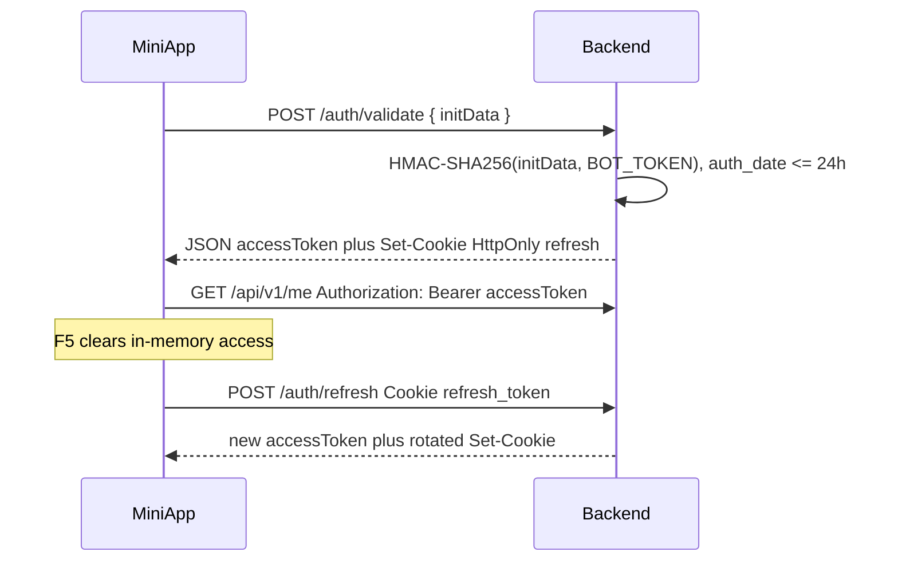

# API

Базовый URL в dev: `http://localhost:8080`. Все тела запросов и ответов — JSON. Актуальная спецификация генерируется из аннотаций `@Route` в `backend/routes/**` и доступна на `/docs` (Swagger UI) и `/openapi.json`.

Номера в скобках — пункты функционала из [docs/README.md](../README.md).

## Общие правила

- Публичные роуты: `/`, `/health`, `/version`, `/auth/*`, `/docs`, `/openapi.json`. Если рядом есть сборка Flutter Web (`frontend/build/web/index.html` или `frontend/.build/web/index.html`), `GET /` отдаёт Mini App, а не JSON; остальные пути из этого списка по-прежнему API.
- Всё под `/api/v1/**` требует `Authorization: Bearer <accessToken>`. Проверку делает `backend/routes/api/_middleware.dart`; в контекст кладётся `AuthUser` (`context.read<AuthUser>()`). При `DEBUG_AUTH=true` принимается и фиксированная строка из `DEBUG_TOKEN` (не JWT). В Swagger UI: **Authorize** → вставить токен без префикса `Bearer`.
- Ошибки всегда в формате `{ "error": "<сообщение>" }`.
- Тела `POST`/`PATCH` на клиенте — модели в `melist_core` (`CreateWishlistBody`, `PatchWishBody`, …). PATCH: нет ключа — поле не менять; `null` — сбросить (`jsonOmit` в конструкторе).
- Коды: `200` ok, `201` создано, `204` удалено без тела, `400` невалидное тело, `401` нет/плохой токен, `403` чужой ресурс, `404` не найдено, `405` метод не поддерживается, `501` ещё не реализовано.
- Массовые операции и сортировка выполняются методами на коллекции (`PATCH`/`DELETE /api/v1/wishlists`), а не отдельными статическими путями рядом с `[id]` — в Dart Frog динамический сегмент может перехватить такой путь.

## Аутентификация

Access JWT — короткоживущий, только в JSON (`AuthSessionModel`). Refresh — opaque-токен в HttpOnly cookie `refresh_token` (`Secure` по флагу `COOKIE_SECURE`, `SameSite=Lax`, `Path=/auth`). В JSON refresh **нет**. `/api/v1/**` по-прежнему только `Authorization: Bearer`.



### `POST /auth/validate`

Тело: `{ "initData": "<raw WebApp.initData>" }`.

Ответ `200`:

```json
{
  "accessToken": "<jwt>",
  "tokenType": "Bearer",
  "expiresIn": 900,
  "user": { "id": 123, "firstName": "…", "lastName": "…", "username": "…", "avatarUrl": "…" }
}
```

Заголовок `Set-Cookie`: `refresh_token=…; Path=/auth; HttpOnly; SameSite=Lax` (`Secure` если `COOKIE_SECURE=true`). Клиент: `AuthSessionModel` в `melist_core` (`fromJson` тела ответа) — поле refresh в модели нет.

`400` — `initData` отсутствует; `401` — `Invalid initData` / `Expired initData`.

JWT: `sub` = Telegram user id, claims `firstName`, `lastName`, `username`. TTL access по умолчанию 15 минут (`ACCESS_TOKEN_TTL_SECONDS`). Когда access истечёт — `POST /auth/refresh` с cookie, без повторного `initData`.

### `POST /auth/refresh`

Тела нет. Браузер присылает cookie `refresh_token`. Сервер проверяет хеш в `refresh_tokens`, ротирует токен и отвечает тем же JSON, что validate, плюс новый `Set-Cookie`.

`401` `{ "error": "Invalid refresh token" }` — нет cookie, просрочен, неизвестен или уже отозван. Повтор отозванного токена отзывает все refresh этого пользователя и тоже даёт `401` с `Set-Cookie` `Max-Age=0`.

### `POST /auth/logout`

Отзывает текущий refresh (если cookie есть) и всегда отвечает `204` с очисткой cookie (`Max-Age=0`), даже без cookie.

### `GET /auth/debug`

Только при `DEBUG_AUTH=true`. Возвращает фиксированный Bearer, чтобы в Swagger и curl не проходить Telegram `initData`.

Ответ `200`:

```json
{
  "accessToken": "dev-admin",
  "tokenType": "Bearer",
  "user": { "id": 1, "firstName": "Debug", "lastName": "Admin", "username": "debug_admin" }
}
```

Дальше: `Authorization: Bearer dev-admin` на `/api/v1/**`. Пользователь с `DEBUG_USER_ID` создаётся на старте сервера. `404` — флаг выключен. На проде не включать.

### `GET /version`

Публичный. Версия из `backend/pubspec.yaml` (в Docker-образе файл лежит рядом с сервером; если его нет — запасная константа сборки).

Ответ `200`:

```json
{ "version": "0.1.2" }
```

`405` — метод не GET.

## Профиль

### `GET /api/v1/me` (22)

Текущий пользователь: данные из Telegram + настройки. Если строки в `users` ещё нет, она создаётся из JWT.

```json
{ "id": 1, "firstName": "…", "lastName": "…", "username": "…", "nickname": "…", "avatarUrl": "…",
  "birthday": "1990-05-12", "theme": "dark" }
```

### `PATCH /api/v1/me` (23, 26)

Тело: `{ "birthday"?: "YYYY-MM-DD" | null, "nickname"?: string | null, "theme"?: "light" | "dark" | "system" }`. `null` у `birthday` сбрасывает дату. `nickname` по умолчанию — `firstName` и, если фамилия не пустая, `lastName` через пробел. `null` или пустая строка возвращают этот вариант. Ответ — как `GET /api/v1/me`.

### `GET /api/v1/me/entitlements` (29)

Доступ к дополнительным функциям: `{ "premiumUntil": "<iso>" | null, "sources": ["ad", "donation"] }`.

### `GET /api/v1/users/{id}` (25)

Публичный профиль пользователя. В `wishlists` — все его вишлисты с `visibility = public` и вишлисты с `visibility = link`, которые текущий пользователь уже добавил в избранное. Черновики не отдаются. Публичный вишлист можно открыть с профиля: если `shareToken` ещё не было, он создаётся при этом запросе. В каждом списке `items` — желания по `position`. `404`, если пользователя нет.

## Вишлисты

Файлы: `backend/routes/api/v1/wishlists/`.

### `GET /api/v1/wishlists` (2.1)

Свои вишлисты, отсортированные по `position`. В каждом списке `items` — желания по `position`, как в карточке.

### `POST /api/v1/wishlists` (1)

```json
{ "name": "День рождения", "visibility": "public" | "draft" | "link", "wishIds": [1, 2] }
```

`wishIds` — опционально (1.3). Ответ `201` с созданным вишлистом.

### `PATCH /api/v1/wishlists` (5.1)

Сортировка: `{ "order": [3, 1, 2] }` — полный список id в новом порядке. `204`.

### `DELETE /api/v1/wishlists` (6.2)

Массовое удаление: `{ "ids": [1, 2] }`. `204`.

### `GET /api/v1/wishlists/{id}` (2.2)

Карточка вишлиста с желаниями (`items` по `position`).

### `PATCH /api/v1/wishlists/{id}` (3)

`{ "name"?, "description"?, "visibility"?: "public" | "draft" | "link" }`. `description: null` или пустая строка снимает описание.

### `DELETE /api/v1/wishlists/{id}` (6.1)

`204`.

### `POST /api/v1/wishlists/{id}/wishes` (4)

Одно из трёх тел:

- `{ "wish": { "name", "price"?, "url"?, "description"?, "coverUrl"? } }` — новое желание (4.1)
- `{ "wishId": 10 }` — своё существующее (4.2)
- `{ "copyFromWishId": 42 }` — копия с чужого вишлиста (4.3)

Ответ `201` — добавленное желание. Повторная привязка того же `wishId` — `409`.

### `PATCH /api/v1/wishlists/{id}/wishes` (5.2)

Сортировка желаний внутри вишлиста: `{ "order": [wishId, …] }`. `204`.

### `DELETE /api/v1/wishlists/{id}/wishes/{wishId}`

Убрать желание из вишлиста (само желание не удаляется). `204`.

### `POST /api/v1/wishlists/{id}/share` (7.1)

Создать или вернуть ссылку доступа: `{ "shareToken": "…", "url": "https://t.me/<bot>?startapp=wl_<token>" }`. Имя бота — `BOT_USERNAME`. Путь без short name открывает Main Mini App; `/<shortName>` открыл бы только именованное приложение.

Пункт 7.2 («поделиться») — на клиенте через Telegram share.

### `GET /api/v1/users/{id}/share`

Возвращает ссылку на публичный профиль в Telegram Mini App: `{ "url": "https://t.me/<bot>?startapp=profile_<id>" }`. Имя бота берётся из `BOT_USERNAME`.

### `GET /api/v1/shared/{token}` (7, 8.1)

Просмотр вишлиста по ссылке-приглашению для `public` и `link`. `draft` для не-владельца — `404`. Токен — значение `shareToken` или `wl_<shareToken>` из `startapp`. В `items` все желания списка.

## Избранное

Файлы: `backend/routes/api/v1/favorites/`.

- `GET /api/v1/favorites` (9) — чужие вишлисты в избранном, по `position`. Черновик не входит в список, даже если строка избранного осталась. В `items` все желания. У каждого вишлиста `ownerNickname` — ник владельца, а если он не задан, имя и фамилия. `PATCH` перечисляет только видимые элементы, без черновиков.
- `POST /api/v1/favorites` (8.1) — `{ "shareToken": "…" }` → `201`. Свой вишлист — `400`, повтор — `409`.
- `PATCH /api/v1/favorites` (10) — `{ "order": [wishlistId, …] }` → `204`
- `DELETE /api/v1/favorites/{wishlistId}` (11) → `204`

## Желания

Файлы: `backend/routes/api/v1/wishes/`.

### `GET /api/v1/wishes` (16, 17)

Свои желания, новые сверху. Query: `query` — поиск по названию (17.1, `ILIKE`); `mine=true` — только свои (17.2, значение по умолчанию; иное — `400`). Пагинация: `limit` (по умолчанию 50, максимум 100), `offset`. Ответ — массив.

### `POST /api/v1/wishes` (12)

```json
{ "name": "Наушники", "price": 12000, "url": "https://…", "description": "…", "coverUrl": "https://…",
  "status": "draft" | "free" | "reserved" }
```

Обязательно только `name`. `201`.

### `DELETE /api/v1/wishes` (21.2)

`{ "ids": [1, 2] }` → `204`.

### `GET /api/v1/wishes/{id}`

Одно своё желание. В `wishlists` — вишлисты владельца, куда оно добавлено: `[{ "id", "name" }]`, по `position` вишлиста. Если таких нет, поля нет.

### `PATCH /api/v1/wishes/{id}` (18, 20)

Любые поля из `POST`, включая `status` (20).

### `DELETE /api/v1/wishes/{id}` (21.1)

`204`.

### `POST /api/v1/wishes/{id}/duplicate` (13)

Копия своего желания. `201`.

### `GET /api/v1/reservations`

Чужие хотелки, которые забронировал текущий пользователь. Новые сверху. У каждой `reservedByMe: true` и `ownerNickname` — ник владельца, а если он не задан, имя и фамилия. Идентификатор того, кто забронировал, не отдаётся.

## Подписки

Файлы: `backend/routes/api/v1/subscriptions/`. Свой вишлист или свой профиль — `400`. Чужой черновик вишлиста — `404`. Повтор — `409`. Список — новые сверху; в списке вишлистов только `public`.

- `GET /api/v1/subscriptions/wishlists` (31) — публичные вишлисты, на которые подписан пользователь. В каждом списке `items` — желания по `position`.
- `POST /api/v1/subscriptions/wishlists` (30) — `{ "wishlistId": 1 }` → `201` с вишлистом и его `items`.
- `DELETE /api/v1/subscriptions/wishlists/{wishlistId}` (32) → `204`
- `GET /api/v1/subscriptions/users` (34) — профили, на которые подписан пользователь.
- `POST /api/v1/subscriptions/users` (33) — `{ "userId": 1 }` → `201` с пользователем.
- `DELETE /api/v1/subscriptions/users/{userId}` (35) → `204`

## Монетизация

- `POST /api/v1/ads/reward` (29.1) — подтверждение просмотра рекламы: `{ "provider": "adsgram", "payload": "…" }` → обновлённые entitlements. Показ рекламы (27.1) — SDK на клиенте.
- `POST /api/v1/donations` (28, 29.2) — создать инвойс Telegram Stars: `{ "amount": 100 }` → `{ "invoiceLink": "…" }`.

## Соответствие функционал → эндпоинт

- 1 → `POST /api/v1/wishlists`
- 2 → `GET /api/v1/wishlists`, `GET /api/v1/wishlists/{id}`
- 3 → `PATCH /api/v1/wishlists/{id}`
- 4 → `POST /api/v1/wishlists/{id}/wishes`
- 5 → `PATCH /api/v1/wishlists`, `PATCH /api/v1/wishlists/{id}/wishes`
- 6 → `DELETE /api/v1/wishlists/{id}`, `DELETE /api/v1/wishlists`
- 7 → `POST /api/v1/wishlists/{id}/share`, `GET /api/v1/shared/{token}`
- 8–11 → `/api/v1/favorites`
- 12, 16–21 → `/api/v1/wishes`
- 13 → `POST /api/v1/wishes/{id}/duplicate`
- 22, 23, 26 → `/api/v1/me`
- 25 → `GET /api/v1/users/{id}`
- 27–29 → `POST /api/v1/ads/reward`, `POST /api/v1/donations`, `GET /api/v1/me/entitlements`
- 30–35 → `/api/v1/subscriptions/*`

## Статус реализации

Работают: `/`, `/health`, `/version`, `/auth/validate`, `POST /auth/refresh`, `POST /auth/logout`, `GET /auth/debug`, CRUD вишлистов (`GET`/`POST`/`PATCH`/`DELETE /api/v1/wishlists`, `GET`/`PATCH`/`DELETE /api/v1/wishlists/{id}`), CRUD желаний (`GET`/`POST`/`DELETE /api/v1/wishes`, `GET`/`PATCH`/`DELETE /api/v1/wishes/{id}`, `POST /api/v1/wishes/{id}/duplicate`), желания внутри вишлиста (`POST`/`PATCH /api/v1/wishlists/{id}/wishes`, `DELETE /api/v1/wishlists/{id}/wishes/{wishId}`), шеринг (`POST /api/v1/wishlists/{id}/share`, `GET /api/v1/shared/{token}`, `POST`/`DELETE /api/v1/shared/{token}/wishes/{wishId}/reservation`), свои брони (`GET /api/v1/reservations`), избранное (`GET`/`POST`/`PATCH /api/v1/favorites`, `DELETE /api/v1/favorites/{wishlistId}`), профиль (`GET`/`PATCH /api/v1/me`, `GET /api/v1/users/{id}`), подписки (`GET`/`POST /api/v1/subscriptions/wishlists`, `DELETE /api/v1/subscriptions/wishlists/{wishlistId}`, `GET`/`POST /api/v1/subscriptions/users`, `DELETE /api/v1/subscriptions/users/{userId}`). Остальные `/api/v1/**` — заглушки: проверяют метод и Bearer JWT, отвечают `501 { "error": "Not implemented" }`. Очередь работ — [roadmap.md](roadmap.md) (монетизация 27–29 там не планируется).
