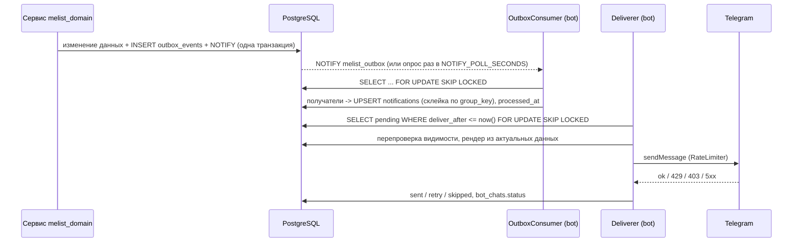

# Уведомления о подписках

Как изменения в вишлистах и профилях превращаются в сообщения в Telegram. Архитектура и конфигурация бота — [README.md](README.md). Подписки — функции 30–35 из [docs/README.md](../README.md).

## Конвейер



Два шага разделены намеренно. Раскладка (fan-out) быстрая и идёт сразу. Доставка медленная, её сдерживают лимиты Telegram. Если у профиля тысячи подписчиков, это не задерживает обработку следующих событий.

## События

Событие пишет сервис `melist_domain` внутри своей транзакции через `OutboxRepository(tx).add(...)`. Пишется только факт, без текста сообщения. Текст собирается при доставке из актуальных данных.

| `type` | Когда пишется | Поля | Получатели |
|---|---|---|---|
| `wishlist.published` | список создан как `public` или видимость сменилась на `public` | `actor_id`, `wishlist_id` | подписчики владельца (`user_subscriptions`) |
| `wishlist.wishes_added` | в `public`-список добавлены желания: новые, свои существующие или скопированные (4.1–4.3), или `wishIds` при создании | `wishlist_id`, `payload.wishIds` | подписчики списка ∪ подписчики владельца |
| `wishlist.wishes_removed` | желание убрано из `public`-списка или удалено целиком | `wishlist_id`, `payload.wishIds`, `payload.names` | подписчики списка |
| `wishlist.updated` | у `public`-списка изменились название или описание | `wishlist_id`, `payload.fields` | подписчики списка |
| `wish.updated` | изменились название, цена, ссылка или описание желания, которое стоит хотя бы в одном `public`-списке | `wish_id`, `payload.fields` | подписчики этих списков |
| `wishlist.closed` | `public`-список удалён или стал `draft`/`link` | `wishlist_id`, `payload.name`, `payload.recipientIds` | подписчики списка на момент события |
| `profile.updated` | изменились никнейм или дата рождения | `actor_id`, `payload.fields` | подписчики профиля |

Правила, общие для всех событий:

- **Только публичное.** Для списков `draft` и `link` события не пишутся. При доставке видимость проверяется ещё раз: если список успел стать непубличным, уведомление получает статус `skipped`. Исключение — `wishlist.closed`.
- **Статус брони не уведомляется никогда.** Смена `status` желания (20) не порождает событие, иначе владелец узнает о подарке.
- **Автор изменения уведомлений не получает**, даже если подписан сам на себя через чужой список.
- **Удаления фиксируют получателей заранее.** При `DELETE` подписки удаляются каскадом, поэтому `wishlist.closed` кладёт `recipientIds` и снимок названия в `payload` в той же транзакции.
- Для `PATCH` без фактических изменений (значение то же) событие не пишется. Сервис сравнивает старое и новое значение внутри транзакции. `WishlistService.update` для этого переводится на `_transaction` с чтением строки `FOR UPDATE`.

## Склейка (debounce)

Пользователь, добавивший 10 желаний подряд, должен вызвать у подписчика одно сообщение, а не десять.

- `group_key = <recipient_id>:<scope>`, где `scope` — `wl:<wishlist_id>` для событий списка и его желаний, `user:<actor_id>` для `profile.updated` и `wishlist.published`.
- Пока у получателя есть уведомление `pending` с тем же `group_key`, новое событие сливается в него. `payload` объединяется (множества `wishIds`, `fields`), `deliver_after = min(now() + NOTIFY_DEBOUNCE_SECONDS, created_at + NOTIFY_MAX_DELAY_SECONDS)`.
- Взаимоисключающие изменения сокращаются при рендере: желание, добавленное и удалённое внутри окна, не упоминается вовсе.
- Уникальность обеспечивает частичный индекс `UNIQUE (group_key) WHERE status = 'pending'`, слияние — `INSERT ... ON CONFLICT ... DO UPDATE`.

## Доставка

Кому можно писать: `bot_chats.status = 'active'` и `notification_settings.enabled`. Остальные уведомления при раскладке не создаются, чтобы не копить мусор.

Ответы Telegram:

| Ответ | Действие |
|---|---|
| `ok` | `status = 'sent'`, `sent_at`, `telegram_message_id` |
| `429` с `retry_after` | глобальная пауза RateLimiter на `retry_after`, уведомление остаётся `pending`, попытка не считается |
| `403` (бот заблокирован, пользователь удалён) | `bot_chats.status = 'blocked'`, все `pending` этого получателя → `skipped` |
| `400 chat not found` | то же, что `403` |
| другой `400` | `failed` с `last_error`: ошибка в рендере, повтор бесполезен |
| `5xx`, таймаут, сеть | `attempts + 1`, `deliver_after = now() + 2^attempts * 10 с`; после `NOTIFY_MAX_ATTEMPTS` → `failed` |

RateLimiter: token bucket на `NOTIFY_RATE_PER_SECOND` на процесс и не больше одного сообщения в секунду в один чат. Перед масштабированием бота на несколько реплик общий лимит делится между ними или переносится в БД.

## Право писать пользователю

Бот может написать только тому, кто это разрешил. Источники статуса в `bot_chats`:

| Сигнал | Кто обрабатывает | Результат |
|---|---|---|
| `/start` в чате | бот | `active` |
| `message.write_access_allowed` (пользователь согласился в `WebApp.requestWriteAccess()`) | бот | `active` |
| `my_chat_member`: `kicked` | бот | `blocked` |
| `my_chat_member`: `member` | бот | `active` |
| `allows_write_to_pm=true` в `initData` при `POST /auth/validate` | backend | `active`, если строки нет или статус `unknown` |
| `403` при отправке | бот | `blocked` |

Frontend: после авторизации, если `initDataUnsafe.user.allows_write_to_pm` не `true` и пользователь подписался хотя бы на что-то, Mini App один раз показывает объяснение и вызывает `requestWriteAccess()`. Отказ запоминается локально и повторно не запрашивается до явного включения в настройках.

## Сообщения

- HTML parse mode. Пользовательские строки экранируются (`&`, `<`, `>`).
- Под сообщением inline-кнопки:
  - «Открыть» — URL `https://t.me/<BOT_USERNAME>?startapp=profile_<ownerId>`. Ссылку `profile_` фронт уже разбирает в `home_page.dart`. Когда появится открытие публичного списка по id, кнопка ведёт на `startapp=list_<wishlistId>`.
  - «Не присылать про этот список» — `callback_data=mute_wl:<id>`; для профиля — `mute_user:<id>`.
- Примеры:
  - `<b>Аня</b> добавила 3 желания в «День рождения»: Наушники, Книга и ещё 1`
  - `<b>Аня</b> открыла новый вишлист «Новый год»`
  - `Вишлист «Свадьба» больше недоступен`

## Модель данных

Миграция `m0006_notifications` в `melist_domain`. После реализации SQL переносится в [data-model.md](../backend/data-model.md).

```sql
DO $$ BEGIN
  IF NOT EXISTS (SELECT 1 FROM pg_type WHERE typname = 'bot_chat_status') THEN
    CREATE TYPE bot_chat_status AS ENUM ('unknown', 'active', 'blocked');
  END IF;
  IF NOT EXISTS (SELECT 1 FROM pg_type WHERE typname = 'notification_status') THEN
    CREATE TYPE notification_status AS ENUM ('pending', 'sent', 'skipped', 'failed');
  END IF;
END $$;

-- Можно ли боту писать пользователю. chat_id личного чата = user id.
CREATE TABLE IF NOT EXISTS bot_chats (
  user_id      BIGINT PRIMARY KEY REFERENCES users(id) ON DELETE CASCADE,
  status       bot_chat_status NOT NULL DEFAULT 'unknown',
  started_at   TIMESTAMPTZ,
  blocked_at   TIMESTAMPTZ,
  updated_at   TIMESTAMPTZ NOT NULL DEFAULT now()
);

CREATE TABLE IF NOT EXISTS notification_settings (
  user_id      BIGINT PRIMARY KEY REFERENCES users(id) ON DELETE CASCADE,
  enabled      BOOLEAN NOT NULL DEFAULT true,
  updated_at   TIMESTAMPTZ NOT NULL DEFAULT now()
);

ALTER TABLE wishlist_subscriptions ADD COLUMN IF NOT EXISTS muted BOOLEAN NOT NULL DEFAULT false;
ALTER TABLE user_subscriptions     ADD COLUMN IF NOT EXISTS muted BOOLEAN NOT NULL DEFAULT false;

CREATE TABLE IF NOT EXISTS outbox_events (
  id            BIGSERIAL PRIMARY KEY,
  type          TEXT NOT NULL,
  actor_id      BIGINT NOT NULL,
  wishlist_id   BIGINT,
  wish_id       BIGINT,
  payload       JSONB NOT NULL DEFAULT '{}',
  created_at    TIMESTAMPTZ NOT NULL DEFAULT now(),
  processed_at  TIMESTAMPTZ
);
CREATE INDEX IF NOT EXISTS outbox_events_pending_idx
  ON outbox_events (id) WHERE processed_at IS NULL;

CREATE TABLE IF NOT EXISTS notifications (
  id                   BIGSERIAL PRIMARY KEY,
  recipient_id         BIGINT NOT NULL REFERENCES users(id) ON DELETE CASCADE,
  group_key            TEXT NOT NULL,
  kind                 TEXT NOT NULL,
  payload              JSONB NOT NULL DEFAULT '{}',
  status               notification_status NOT NULL DEFAULT 'pending',
  attempts             INTEGER NOT NULL DEFAULT 0,
  deliver_after        TIMESTAMPTZ NOT NULL,
  created_at           TIMESTAMPTZ NOT NULL DEFAULT now(),
  sent_at              TIMESTAMPTZ,
  telegram_message_id  BIGINT,
  last_error           TEXT
);
CREATE UNIQUE INDEX IF NOT EXISTS notifications_pending_group_idx
  ON notifications (group_key) WHERE status = 'pending';
CREATE INDEX IF NOT EXISTS notifications_due_idx
  ON notifications (deliver_after) WHERE status = 'pending';
```

`outbox_events.wishlist_id` и `wish_id` без внешних ключей: событие должно пережить удаление сущности.

Очистка: бот раз в сутки удаляет `outbox_events` с `processed_at` старше 7 дней и `notifications` в статусах `sent`/`skipped`/`failed` старше 30 дней.

### Владение таблицами

| Таблица | Пишет | Читает |
|---|---|---|
| `outbox_events` | backend (INSERT); бот (`processed_at`, очистка) | бот |
| `notifications` | бот | бот; позже backend для ленты в Mini App |
| `bot_chats` | бот; backend только при `/auth/validate` (`unknown` → `active`) | оба |
| `notification_settings`, `*_subscriptions.muted` | backend (`PATCH`), бот (кнопки mute) | оба |

## API backend для настроек

| Эндпоинт | Описание |
|---|---|
| `GET /api/v1/me/notifications` | `{ "enabled": true, "botStatus": "active" \| "blocked" \| "unknown" }` |
| `PATCH /api/v1/me/notifications` | `{ "enabled": false }` |
| `PATCH /api/v1/subscriptions/wishlists/{wishlistId}` | `{ "muted": true }` |
| `PATCH /api/v1/subscriptions/users/{userId}` | `{ "muted": true }` |

`GET /api/v1/subscriptions/*` дополнительно возвращают `muted`. Контракты добавляются в [api.md](../backend/api.md) по правилам backend.

## Вне первой версии

- Режим дайджеста (раз в день) поверх тех же `notifications`: `notification_settings.mode`, `deliver_after` на ближайшее окно.
- Напоминание о дне рождения подписки за N дней (cron в боте, без outbox).
- Лента уведомлений в Mini App (`GET /api/v1/me/notifications/feed`).
- Тихие часы по часовому поясу пользователя.
